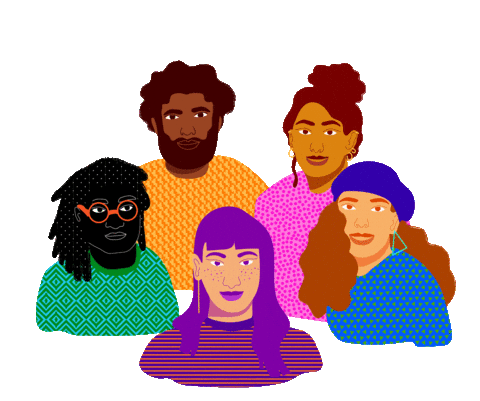
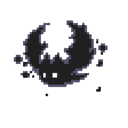

<h2> Hi there, I'm Emanuel </h2>
<em>
  
</br>
  01010100 01101000 01100101 01110010 01100101 00100000 01101001 01110011 00100000 01101110 01101111 01110100 01101000 01101001 01101110 01100111 00100000 01100011 01110101 01110010 01101001 01101111 01110101 01110011 00100000 01101000 01100101 01110010 01100101 00101110 00101110 00101110 


### A little more about me...

```java
Map<String, Object> emanuel = Map.ofEntries(
    Map.entry("backend", List.of("Java", "Spring Boot", "Python", "Flask")),
    Map.entry("databases", List.of("PostgreSQL", "Oracle", "MongoDB")),
    Map.entry("tools", List.of("Docker", "Postman", "Git", "GitHub", "GitHub Actions")),
    Map.entry("architecture", List.of("Microservices", "REST APIs", "Hexagonal Architecture")),
    Map.entry("challenge", "Deepening my knowledge in Hexagonal Architecture, REST APIs and Microservices")
);
```

 <em><b>I love connecting with different people,</b> so if you want to say <b>hi</b>, I'd be happy to meet you!</em>

### Contats 
<p align="left">
  <a href="https://www.linkedin.com/in/SEU-LINKEDIN/" style="text-decoration: none;"></a>
</p>
